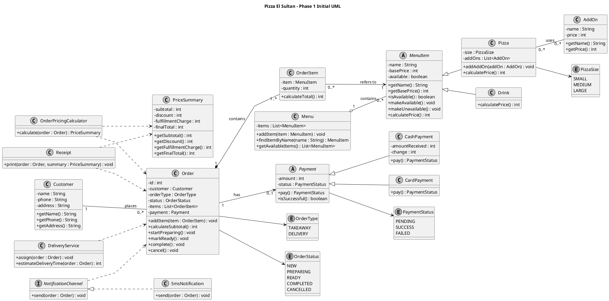
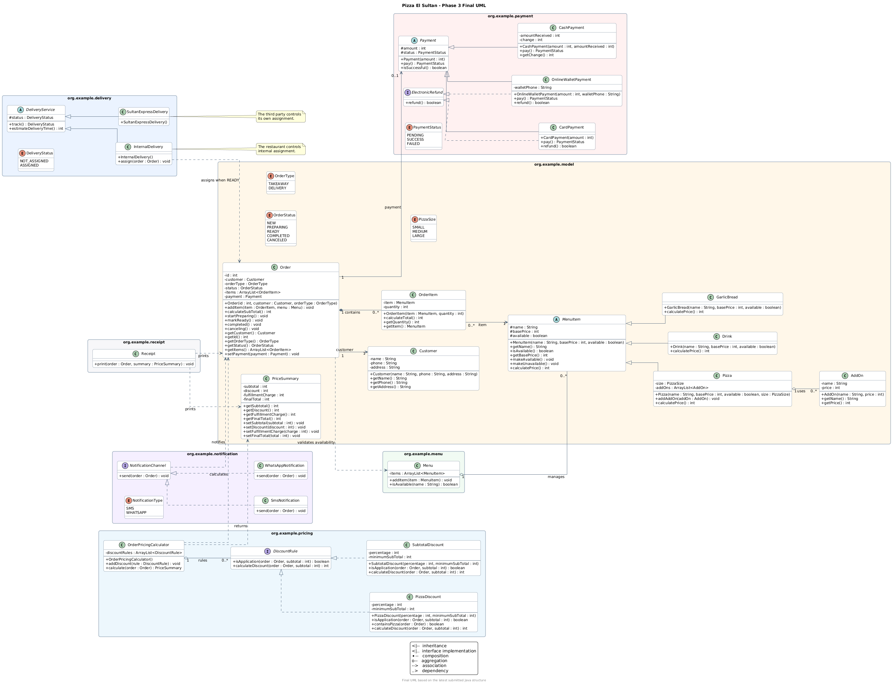

# Pizza El Sultan

A pure Java project for managing restaurant orders, menu items, pricing, payments, delivery, notifications, and receipts.

## How to Run

1. Open the project in IntelliJ IDEA and set the Project SDK to **JDK 17**.
2. If needed, mark `src/main/java` as the Sources Root.
3. Run `org.example.Main` using the Run button next to `main()`.

### Main demonstration

`Main` creates takeaway and delivery orders, calculates pricing and discounts, demonstrates successful card/cash payments and a failed cash payment, and sends SMS/WhatsApp notifications. It also assigns internal delivery while the order is ready, tracks its status, and displays the estimated time. The three edge cases are zero quantity, an unavailable item already in the menu, and an item missing from the menu.

| Scenario | Subtotal | Discount | Delivery charge | Final total | Payment |
|---|---:|---:|---:|---:|---|
| Takeaway | 400 | 60 | 0 | 340 | Successful card payment |
| Delivery | 360 | 0 | 30 | 390 | Successful cash payment; change 100 |
| Failed payment | 170 | 0 | 0 | 170 | Cash received 10; order canceled |

These figures use a Margherita base price of 100 EGP, plus 30 for medium size, 25 for extra cheese, and 15 for olives: 170 EGP per pizza. Main also registers Chicken Ranch (160), Cola (30), Water (15), and Garlic Bread (50) in the menu.

## UML diagrams

### Initial UML

### Final UML

The final diagram contains the 33 types in the supplied code, including `Main`. The full and summary diagrams have the same classes and relationships; the summary hides the members.

## Phase 3 — Main architectural changes

| Initial design | Final implementation | Why this change helps |
|---|---|---|
| Pricing had no separate discount rules. | `DiscountRule`, `SubtotalDiscount`, and `PizzaDiscount` work with `OrderPricingCalculator`. | Different discounts can be added without putting their logic inside the calculator. |
| Delivery used one concrete service. | Abstract `DeliveryService` has `InternalDelivery` and `SultanExpressDelivery` subclasses. Only internal delivery exposes `assign()`. | Sultan Express does not need to offer driver assignment through our system. |
| Payment supported cash and card. | `OnlineWalletPayment` is added. Card and wallet implement `ElectronicRefund`. | Electronic refund is available only to the payment types that need it. |
| Notification supported SMS. | `WhatsAppNotification` also implements `NotificationChannel`. | Either channel can use the same notification contract. |
| Menu items included pizza and drink. | `GarlicBread` also extends `MenuItem`. | It works with the existing order-line pricing without pizza-specific fields. |
| `Order.addItem()` accepted only an order line. | It also receives `Menu` and checks availability. | Unavailable items are not added, although this introduces a dependency on `Menu`. |

Other differences include `ArrayList` instead of `List`, protected base fields, additional getters/setters, and exact implementation names such as `completed()` and `canceling()`.

The final UML shows associations for stored references. The code does not enforce exclusive ownership or shared lifetime, so it does not prove strict UML composition. It also allows empty collections, shown as `0..*`.

## Design Review

### 1. Briefly describe your architecture.

The project separates orders and menu items from pricing, payment, delivery, notification, and receipt logic. `Order` stores the customer, items, and payment. `OrderPricingCalculator` calculates the price summary, while `Receipt` prints it. Abstract classes and interfaces allow different item, payment, and notification types to share common contracts.

### 2. Give one example where you applied SRP.

`Receipt` is responsible for printing order details. It does not calculate discounts or process payments. For example, changing the receipt format does not require changing `PizzaDiscount` or `CashPayment`.

### 3. How can a new feature or type be added without heavily modifying existing code?

A new discount can implement `DiscountRule` and be registered using `addDiscount()`. The calculator already calls the interface, so it does not need a new discount-specific branch. Similarly, a new notification channel can implement `NotificationChannel`.

### 4. Did you use inheritance? If yes, explain why the child can genuinely substitute for its parent.

Yes. `Pizza`, `Drink`, and `GarlicBread` extend `MenuItem`. `OrderItem` uses a `MenuItem` and calls `calculatePrice()` without needing to know its actual type. Each child supplies its own price calculation while keeping the same method contract.

### 5. Did every implementation actually need every method defined by its interface?

The interfaces are small and focused. SMS and WhatsApp both need `send()`, and both discount rules use applicability checking and discount calculation. Only card and wallet implement `ElectronicRefund`; cash is not forced to provide an electronic refund method.

### 6. Which high-level parts of your system depend on abstractions rather than concrete implementations?

`OrderPricingCalculator` works with `DiscountRule` instead of a specific discount class. `Order` stores `Payment`, and `OrderItem` stores `MenuItem`, so both can work with different subclasses. However, `Order.addItem()` still depends directly on the concrete `Menu` class.

### 7. Where did you choose composition instead of inheritance, and why?

The project uses has-a relationships: an `Order` has order items, and an `OrderItem` has a menu item. An order item is not a kind of order, so inheritance would not fit. This is object composition in the general sense; the code does not enforce the lifetime rules required for strict UML composition.

### 8. Which Phase 2 requirement caused the largest change to your original architecture?

The extra promotion is the largest visible change in the pricing design. The initial UML did not show separate rule types; the final code has `DiscountRule`, `PizzaDiscount`, and `SubtotalDiscount`. This separates each promotion's conditions from the normal total calculation.

### 9. What changed between your Initial UML and Final UML?

The final design adds garlic bread, wallet payment, electronic refund, WhatsApp, discount rules, and separate delivery implementations. It also changes some method signatures and field types to match the actual code. The Phase 3 table above explains the main changes and their reasons.

### 10. If Pizza El Sultan requested five additional payment methods or notification channels tomorrow, approximately how much existing code would need modification?

Normally, five new behaviors would need about five new implementation classes. The existing payment storage in `Order` would not need to change if the new methods fit the `Payment` contract. The selection and construction code in `Main` may need changes to demonstrate the new types. The core classes should not need another branch for each new type.

### 11. Which part of your architecture are you least satisfied with, and why?

Order state handling needs the most improvement. The current code does not prevent adding items after cancellation or completion, and transition methods do not check the previous state. Notification classes also complete the order, which mixes notification behavior with lifecycle management.

### 12. If you restarted the assignment today, what would you design differently?

I would start with stronger validation for prices, delivery information, and order-state changes. I would separate sending notifications from completing orders, and make the active promotion an explicit choice. I would also add the Main scenarios and edge-case tests early to check the design against the requirements.

## Current limitations

The final UML matches the supplied code, but that does not mean every assignment requirement is complete:

- Prices, delivery details, non-empty orders, and terminal-state editing are not fully validated.
- `SubtotalDiscount` uses a strict `>` threshold; the original promotion requires an inclusive threshold at 500 EGP. The calculator also selects the largest discount instead of explicitly selecting one active promotion, and does not guard against a negative final total.
- Card payment always succeeds. Wallet failure is based only on phone length, and electronic refund methods return a boolean without reversing a transaction.
- Delivery state is held per service object, not per order. Sultan Express has no real integration, and sending a notification changes the order to completed.
- The receipt itself does not show payment results, although Main prints them separately. Main demonstrates successful/failed payments, both channels, and internal delivery. It does not demonstrate wallet payment, refund, or Sultan Express.

The Main demonstration has three distinct edge cases, but it does not cover every required validation case. The quantity case throws an exception; unavailable and missing items are rejected without adding them to the order.

These are improvements still needed, not features already implemented.
